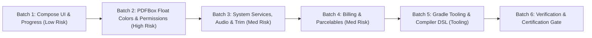

# PDFchemy Android 2.1.1 — Modernization & Deprecation Elimination Plan

**Target Release:** PDFchemy Android 2.1.1 (`versionCode 15`)  
**Tracking Issue:** Issue #18 (Modernization & Upstream Deprecation Elimination)  
**Branch:** `modernization/issue-18-deprecations`  
**Base Commit:** [`16cd730aa72f5ddbfae4587017f6620755c39c49`](file:///e:/backup_ext_hdd/android-projects-2026-07-30/release-validation-2.1.0-2026-10-23/readiness-integration-2026-10-29)  
**Dedicated Worktree:** [`E:\backup_ext_hdd\android-projects-2026-07-30\release-validation-2.1.0-2026-10-23\modernization-issue-18`](file:///e:/backup_ext_hdd/android-projects-2026-07-30/release-validation-2.1.0-2026-10-23/modernization-issue-18)  
**Architect:** Vulcan (Autonomous AI Co-Architect & Master of the Forge)  
**Target:** Eliminate all 99 source deprecation compiler diagnostics across 38 files, modernize build configuration, and verify 0 regressions across all 2,434 tests.

---

## Strategic Overview & Safety Invariants

### Inviolable Modernization Invariants
1. **Zero Behavioral Regressions:** Document processing, rendering, vector redaction, sanitization, and streaming conversion must produce bit-exact or visually identical output.
2. **Strict Normalized Color Math:** When migrating PDFBox RGB APIs (`Int` $\rightarrow$ `Float`), channel values **MUST** be divided by `255.0f` (`r / 255f`). Passing unnormalized integer floats (e.g. `255f`) produces complete black/white clipping and document corruption.
3. **API 24 Compatibility Preservation:** Never remove backward-compatible branches for Android 7.0–13 unless a modern, official AndroidX compatibility wrapper is used.
4. **Isolated Step-by-Step Commits:** Each batch must compile cleanly and pass its targeted test suite before proceeding to the next.

---

## Phase Breakdown: Tasks & Subtasks

### Phase 1: Mechanical Compose UI & Layout Modernization (Low Risk)
*Objective: Eliminate 60+ Compose deprecated icon aliases and indicator overloads across UI screens.*

* [ ] **Task 1.1: Migrate Compose Mirrored Icons to AutoMirrored**
  * *Subtask 1.1.1:* Replace `Icons.Rounded.*` with `Icons.AutoMirrored.Rounded.*` across `MainActivity.kt` (MenuBook, FactCheck, Article, LibraryBooks).
  * *Subtask 1.1.2:* Update navigation and reader screens: `PdfReaderScreen.kt`, `ReflowReaderScreen.kt`, `AttachmentManagerScreen.kt`, `BookletScreen.kt`, `CheckScreens.kt`.
  * *Subtask 1.1.3:* Update tool screens: `DeskewScreen.kt`, `EbookConverterScreen.kt`, `MarkdownStudioScreen.kt`, `OfficeExportScreen.kt`, `OrganizeScreens.kt`, `PageCropperScreen.kt`, `PageOrganizerScreen.kt`.
  * *Subtask 1.1.4:* Update editor and security screens: `PdfEditorScreen.kt`, `QuickFillSignScreen.kt`, `RedactionScreen.kt`, `RepairPdfScreen.kt`, `ToolSearch.kt`.
  * *Verification:* Confirm RTL/LTR layout mirroring and accessibility content descriptions remain functional.
* [ ] **Task 1.2: Modernize Material3 Progress Indicators**
  * *Subtask 1.2.1:* In `ReflowReaderScreen.kt:568`, replace deprecated `LinearProgressIndicator(progress: Float)` with the lambda overload `progress = { ... }`.
  * *Verification:* Verify smooth reader progress animation during document pagination.

---

### Phase 2: PDFBox Android Core API Modernization (Critical Integrity)
*Objective: Migrate deprecated PDFBox integer color APIs and permission aliases without altering rendered visual geometry or permission bitmasks.*

* [ ] **Task 2.1: Migrate Content Stream RGB Methods to Normalized Floats**
  * *Subtask 2.1.1:* Audit and migrate `setStrokingColor(Int, Int, Int)` to `setStrokingColor(r / 255f, g / 255f, b / 255f)` across production modules (`Markdown`, `Booklet`, `HeaderFooter`, `NUp`, `Redaction`, `Stamping`, `Signatures`).
  * *Subtask 2.1.2:* Audit and migrate `setNonStrokingColor(Int, Int, Int)` to `setNonStrokingColor(r / 255f, g / 255f, b / 255f)` across production modules.
  * *Subtask 2.1.3:* Update test fixtures: `ComicBookExportIntegrityTest.kt`, `PowerPointIntegrityTest.kt`, `EditorLargePageExportSecurityTest.kt`, `EditorPageGeometrySecurityTest.kt`, `PrivatePayloadAliasSecurityTest.kt`.
  * *Verification:* Run pixel-oracle and vector redaction comparison to confirm identical RGB rendering (no channel clipping or black wash).
* [ ] **Task 2.2: Modernize AccessPermission Delegation**
  * *Subtask 2.2.1:* In `PdfManipulatorWorker.kt:339`, replace deprecated `setCanPrintDegraded(Boolean)` with `setCanPrintFaithful(Boolean)`.
  * *Verification:* Verify serialized PDF permission bitmask remains 100% compliant with standard PDF encryption specifications.

---

### Phase 3: Android OS Services, Audio & Lifecycle Modernization (Medium Risk)
*Objective: Modernize notification builders, TTS callbacks, and low-memory handlers to align with API 35/36 standards.*

* [ ] **Task 3.1: Modernize Foreground Notification Construction**
  * *Subtask 3.1.1:* In `AudioExportService.kt:50`, update `Notification.Builder(Context)` to `Notification.Builder(Context, channelId)` with version check (`Build.VERSION.SDK_INT >= Build.VERSION_CODES.O`), retaining API 24/25 fallback.
  * *Subtask 3.1.2:* In `AudioExportService.kt:59`, replace legacy `Notification.Action.Builder(Int, ...)` with `Notification.Action.Builder(Icon.createWithResource(...), ...)`.
  * *Verification:* Test background audio export and verify foreground service notification, channel binding, and cancellation action.
* [ ] **Task 3.2: Clean Up TTS Listener Adapter**
  * *Subtask 3.2.1:* In `TtsPcmAssembler.kt:12`, correctly annotate or wrap the required abstract `onError(String)` adapter while delegating to modern `onError(String, Int)` callback.
  * *Verification:* Verify text-to-speech error routing on API 24 and API 34+.
* [ ] **Task 3.3: Modernize Memory Pressure Handlers**
  * *Subtask 3.3.1:* In `ReaderViewportController.kt:121, 127` and `PdfReaderScreen.kt:178`, address deprecated `TRIM_MEMORY_RUNNING_CRITICAL/LOW` by version-gating to modern `ComponentCallbacks2` memory handling on API 35+ while preserving explicit cache budgets on legacy devices.
  * *Verification:* Test large PDF reader viewport under simulated low-memory conditions (`adb shell am send-trim-memory`).

---

### Phase 4: Billing, IPC & Parcelable Modernization (Commerce & Stability)
*Objective: Modernize Google Play Billing response code branches and typed Parcelable bundle extraction.*

* [ ] **Task 4.1: Modernize BillingClient Error Code Handling**
  * *Subtask 4.1.1:* In `BillingManager.kt:265, 297, 402`, audit `BillingResponseCode.SERVICE_TIMEOUT` (-3) and migrate to `BillingResponseCode.SERVICE_UNAVAILABLE` while maintaining backwards-compatible fallback for retry logic.
  * *Verification:* Verify mock billing failure modes and subscription status reconciliation.
* [ ] **Task 4.2: Modernize Java Test Provider Parcelable Extraction**
  * *Subtask 4.2.1:* In `BatchOutputProvider.java:46, 52`, replace deprecated `Bundle.getParcelable(String)` with version-aware `BundleCompat.getParcelable(...)` or `Bundle.getParcelable(String, Class)`.
  * *Verification:* Run native batch output provider instrumentation tests.

---

### Phase 5: Gradle Tooling, Kotlin Options & Compiler DSL (Build Health)
*Objective: Modernize build scripts for AGP 10 readiness and migrate Kotlin compiler options.*

* [ ] **Task 5.1: Modernize `gradle.properties` Options**
  * *Subtask 5.1.1:* Audit and remove/migrate deprecated AGP flags:
    - `android.usesSdkInManifest.disallowed=false`
    - `android.sdk.defaultTargetSdkToCompileSdkIfUnset=false`
    - `android.enableAppCompileTimeRClass=false`
    - `android.builtInKotlin=false`
    - `android.newDsl=false`
    - `android.defaults.buildfeatures.resvalues=true`
    - `android.enableJetifier=true`
  * *Verification:* Run `./gradlew assembleRelease` to confirm AGP 9.2 builds cleanly without AGP 10 removal warnings.
* [ ] **Task 5.2: Migrate `kotlinOptions` to `compilerOptions`**
  * *Subtask 5.2.1:* In all module `build.gradle.kts` files (`app-host`, `pdf-core`, `pdf-ipc`, `pdf-jail`), replace deprecated `android.kotlinOptions { jvmTarget = "1.8" }` with the modern `kotlin.compilerOptions { jvmTarget.set(JvmTarget.JVM_1_8) }` or target Java 17/21 bytecode where supported.
  * *Verification:* Verify Kotlin compilation with `-Pandroid.debug.obsoleteApi=true` confirms zero obsolete variant API warnings.

---

### Phase 6: Full Verification Gauntlet & Release Packaging (Gate)
*Objective: Full regression testing, zero warning compilation verification, and signed release candidate packaging.*

* [ ] **Task 6.1: Full Automated Test Suite Execution**
  * *Subtask 6.1.1:* Run all 658 JVM unit tests (`./gradlew testReleaseUnitTest`).
  * *Subtask 6.1.2:* Run all 1,776 Android security instrumentation tests on API 36 emulator.
* [ ] **Task 6.2: Compiler & Lint Verification**
  * *Subtask 6.2.1:* Compile with deprecation diagnostics enabled to verify 0 unexpected deprecation warnings remain.
  * *Subtask 6.2.2:* Run `./gradlew lintRelease` to confirm 0 errors and 0 fatals.
* [ ] **Task 6.3: Candidate Packaging (`versionCode 15`, Version 2.1.1)**
  * *Subtask 6.3.1:* Package signed release AAB and APK with production keystore `app-host/release.jks`.
  * *Subtask 6.3.2:* Verify 16 KiB alignment (`zipalign` and ELF load segments).
  * *Subtask 6.3.3:* Generate SHA-256 manifest and release handoff dossier.

---

## Execution Dashboard

| Phase | Description | Deprecations Eliminated | Risk Level | Status |
|:---:|---|:---:|:---:|:---:|
| **1** | Mechanical Compose UI & Layout | ~61 | Low | **READY TO START** |
| **2** | PDFBox Android Float Colors & Permissions | ~25 | High | Pending Phase 1 |
| **3** | OS Services, Notifications & Trim Handlers | ~6 | Medium | Pending Phase 2 |
| **4** | Billing Codes & Java Parcelables | ~5 | Medium | Pending Phase 3 |
| **5** | Gradle Tooling & Compiler DSL | Build DSL | Medium | Pending Phase 4 |
| **6** | Verification Gauntlet & 2.1.1 Release Artifacts | Full Suite | Gate | Final Acceptance |
